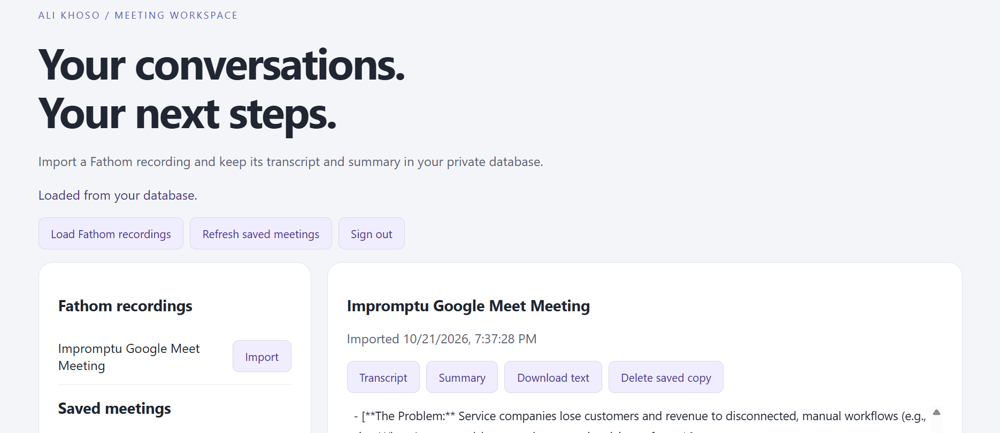
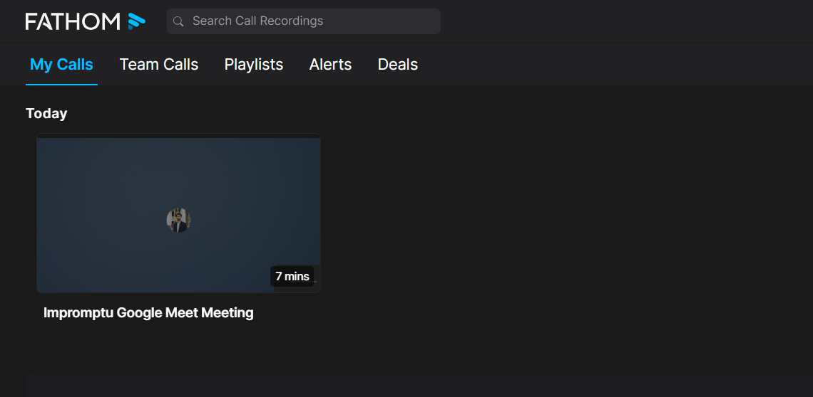
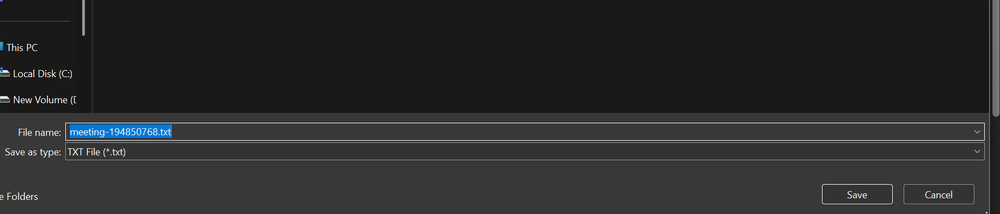
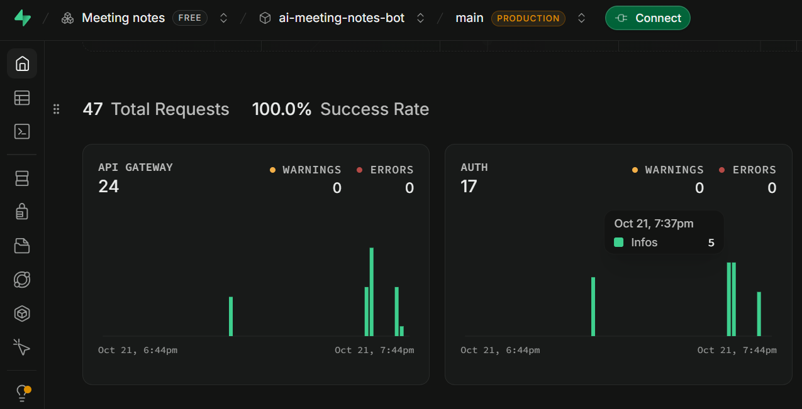
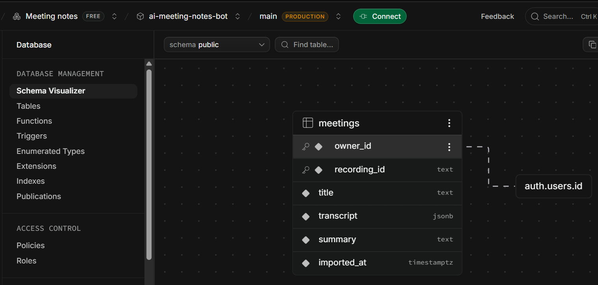

# Meeting Notes — Vercel + Supabase

Private, single-owner dashboard. Fathom records the meeting; click **Import** after processing to store the spoken transcript (speaker, timestamp, text) and Fathom summary in Supabase PostgreSQL. Records survive browser restarts and Vercel redeploys. No Docker or paid AI API is required by this version; provider plan limits still apply.

## Dashboard preview

The preview shows a meeting loaded from Supabase, with controls to view its transcript and summary, download a text copy, or delete the saved copy.

## Setup screenshots

These screenshots show the Fathom recording, exported transcript, Supabase API activity, and database schema used in this project.

## 1. Create your database and login

1. Create a Supabase project at https://supabase.com/dashboard.
2. Open **SQL Editor** and run [`supabase/schema.sql`](supabase/schema.sql). It creates the `meetings` table and enables row-level security.
3. In **Authentication → Users**, create your own email/password user. Confirm the email using the dashboard option. Copy that user's UUID for `ALLOWED_USER_ID`.
4. Disable public sign-ups in Authentication settings. This app is for one owner and one Fathom account.
5. Find the project URL and publishable key (or legacy `anon` key) in project API settings. Do **not** use a secret/service-role key: those bypass row-level security.

## 2. Deploy to Vercel

1. Import `Ali-Khoso/ai-meeting-notes-bot` in Vercel.
2. Set **Root Directory = `cloud`** and framework preset **Other**. Use Node.js 22.x. The included `vercel.json` sets the build and public output directory; API functions remain under `api/`.
3. Add these environment variables for the deployment environment you use:

| Variable | Value |
| --- | --- |
| `SUPABASE_URL` | Your project URL, such as `https://example.supabase.co` |
| `SUPABASE_ANON_KEY` | Publishable key or legacy anon key |
| `ALLOWED_USER_ID` | UUID of the user you created in Supabase Authentication |
| `FATHOM_API_KEY` | Key from Fathom User Settings → API Access |

4. Deploy, open the resulting URL, and sign in with the Supabase user email/password.
5. After a meeting is processed in Fathom, choose **Load Fathom recordings → Import**. The success message appears only after the database write succeeds.
6. Open a saved meeting to read the full transcript or summary and download a text copy. Re-import updates the same `(owner_id, recording_id)` record. Summary unavailable on re-import results in an empty summary plus warning; previous summaries are not retained.

Never put real secrets in GitHub or chat. Environment changes require redeployment. The Fathom key is only used on the server. The app sends database requests with your verified user token, enforcing row-level security as well as the server's user-ID allowlist.

## Meeting joining

Fathom's desktop app/Chrome extension joins and records. This website does not launch a meeting bot. Keep the desktop app running, configure unscheduled Meet recording in Fathom, or use **Add to Meeting** and paste the meeting URL. Host admission and participant recording consent apply.

## Scope and limits

- Manual import after processing, not automatic webhook syncing or live transcription.
- Stores captured speech, not Google Meet text-chat messages or the video file.
- Cloud version includes transcript and Fathom summary. Pain-point AI analysis remains in the existing local Python/Ollama version; it is not implemented in this cloud app.
- Session token stays in browser memory. Refreshing the page or an expired token requires signing in again. Sign out clears this page's memory; it does not revoke other sessions.
- Shows latest 100 saved meetings. Remote Fathom recordings support pagination.
- 2 MB transcript import limit; provider responses limited to 4 MB; network calls time out after 15 seconds. Retry a failed import safely; imports use database upsert.
- Deleting a saved copy affects Supabase only. Existing local Python meeting files are not migrated.
- Your recordings remain in Fathom and imported copies in Supabase. Review sharing and retention settings in both services.

## Validation

From `cloud/`: `npm test` and `npm run build`. No runtime npm dependencies.

Offline tests cover access denial, ID validation, user-scoped database writes/deletion, duplicate-preventing upserts, summary failure, and sanitized provider errors. **Live Supabase policies, Vercel deployment, and Fathom imports have not been tested against your accounts.** After configuring, check:

1. Import a short test meeting and open its transcript.
2. Refresh/sign in again and confirm it persists.
3. Import it again: one database row should remain.
4. Sign out: API calls without a token should return 401.
5. A different Supabase user must receive 403 from this app, and must not read your records directly through Supabase RLS.
6. Delete the test copy and confirm the Fathom original remains.

References: [Vercel Node functions](https://vercel.com/docs/functions/runtimes/node-js), [Supabase row-level security](https://supabase.com/docs/guides/database/postgres/row-level-security), [Fathom API](https://developers.fathom.ai/quickstart).
